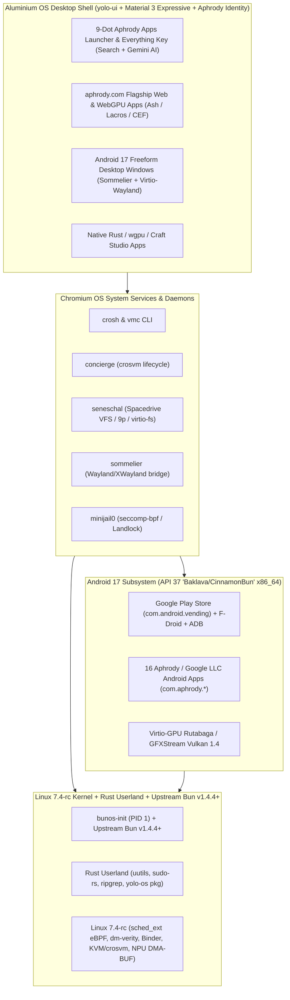

# Aphrody OS — 2026 GoogleBook Laptop Architecture (`os.aphrody.com`)

> [!IMPORTANT]
> **Architectural Hierarchy**:
> - **Aphrody (`aphrody`, `aphrody.com`, `aphrody-labs`)** is the **PUBLIC PRODUCT, PROJECT, AND MAIN ORG**.
> - **YOLO (`yolo-*`, `yolo-rs`)** is the **core library, reusable components, testing, research, and developer environment**.
> - **Aphrody OS (2026 GoogleBook Laptop)** is Goal #2 of Aphrody: a sovereign Google OS combining **Android 17 x64 Google Play image + Chromium OS (CrOS CLI & Ash/Lacros/CEF shell) + Aluminium OS + Linux 7.4-rc + Rust userland + Upstream Bun v1.4.4+**.

---

## 1. System Convergence Architecture

Aphrody OS unifies four execution environments on the 2026 GoogleBook Laptop hardware platform without double-virtualization overhead:



---

## 2. CoreSubsystems

### 2.1 Android 17 (API 37 "Baklava/CinnamonBun") x86_64 Google Play Image
- **ABI & Image**: `google_apis_playstore_x86_64` (API Level 37) with native `x86_64` execution on AMD Zen 5 / Intel Lunar Lake and `aarch64` on Snapdragon X2 / Tensor Laptop.
- **Container & VM Bridge**: Runs inside `crosvm` (ARCVM) or zero-copy container mode (`waydroid`) with `binder_linux`, `virtio-wayland`, and `virtio-gpu` Rutabaga/GFXStream Vulkan 1.4 pass-through.
- **Package Backends**: Managed through `yolo-os pkg` (`play-store`, `fdroid`, `adb`) alongside 22 Linux/BSD/WASM/container package ecosystems.

### 2.2 Chromium OS (CrOS) System Services
- **`crosh`**: Interactive Chromium OS developer shell (`yolo-os crosh`).
- **`vmc` & `concierge`**: Virtual machine and container lifecycle controller managing ARCVM (Android 17), Crostini (Linux development containers), and Bruschetta.
- **`seneschal`**: Secure file-sharing broker bridging host Spacedrive VFS (`drive.aphrody.com`) into guest containers via `virtio-fs`.
- **`sommelier`**: Nested Wayland compositor translating DPI scaling, fractional HiDPI, clipboard, and input events between Android 17 freeform windows and the Aluminium OS desktop.
- **`minijail0` & `dm-verity`**: Verified boot rootfs integrity and capability-locked sandboxing.

### 2.3 Aluminium OS 2026 Windowing Shell
- **Android Desktop + ChromeOS Convergence**: Implements the 2026 Aluminium OS convergence where Android 17 apps run as first-class freeform, resizable, snappable desktop windows alongside Chromium Ash/Lacros web apps and native Rust `yolo-ui` applications.
- **Evolving Google Identity + Aphrody Preset**: Uses HCT/CAM16 dynamic color tokens (`#8C6C88` Pet Mauve seed, `#FFD700` Gold, `#7C5CFF` Violet, `#00D4FF` Cyan, `#17335C` Deep Navy) and the 4-stop Evolving Google gradient (`#4285F4` -> `#9B72CB` -> `#D96570` -> `#F4B400`).

---

## 3. CLI Usage (`yolo-os`)

Inspect and verify the 2026 GoogleBook Laptop OS profile and Chromium OS services directly via `yolo-os`:

```bash
# List available OS profiles
bun C:\src\yolo-os\src\yolo.ts profile list

# Show the 2026 GoogleBook Laptop OS profile summary (or pass --json)
bun C:\src\yolo-os\src\yolo.ts profile show aphrody-googlebook-2026

# Inspect Chromium OS (crosh / vmc / concierge / sommelier / arcvm) status
bun C:\src\yolo-os\src\yolo.ts crosh status
```
