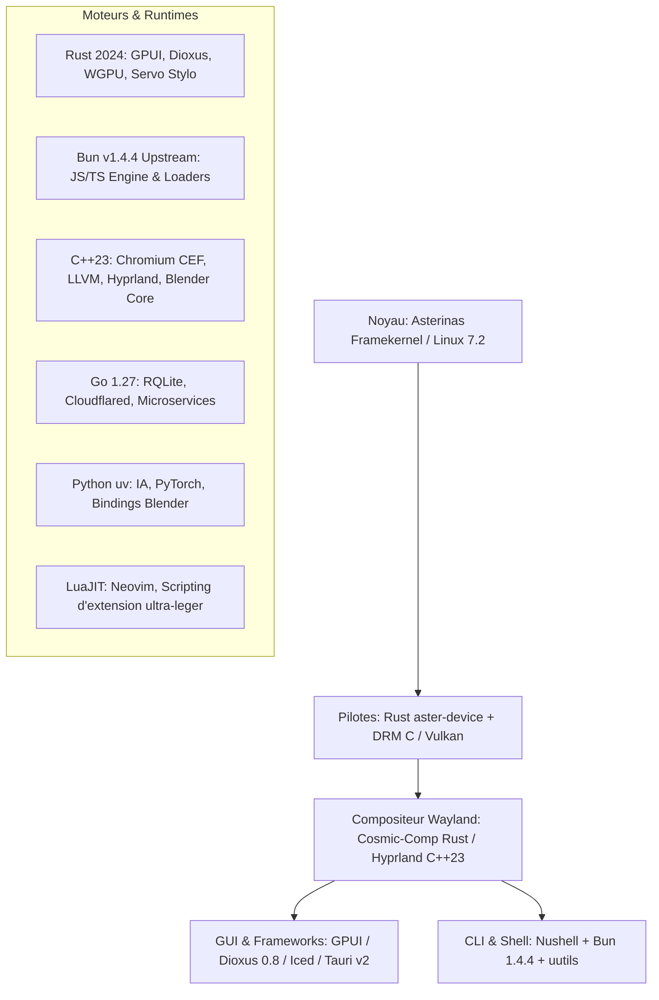

# Architecture Globale YOLO-LFS / OS : Convergence Asterinas, Linux 7, Nix, Arch & Pragmatisme Polyglotte

## 1. Diagnostic des Tentatives Historiques & Erreurs de Redox OS a Eviter

Pour garantir une **robustesse Day One**, il est imperatif d'analyser factuellement pourquoi les OS 100% Rust purs precedents (comme Redox OS) ont echoue a percer sur le bureau et le cloud :

| Composant | Approche Redox OS (Erreurs Historiques) | Solution Canonique YOLO-LFS / OS |
|---|---|---|
| **Architecture Noyau** | Micro-noyau pur avec IPC synchrone lourd entre chaque driver/VFS -> performances IO catastrophiques sur SSD NVMe et context-switches incessants. | **Framekernel Asterinas** (OSTD minimal pour l'unsafe + Safe Rust bare-metal sans passage par IPC de micro-noyau) ou **Noyau Linux 7 LTS hybride** avec patches Rust (`CONFIG_ANDROID_BINDER_IPC_RUST`). |
| **Compatibilite C / ABI** | Reecriture de la libc en Rust (`relibc`) incomplexe, boguée et incapable de lier proprement les gros runtimes C++23, V8, Chromium ou glibc 2.40+. | **Zero dogmatisme ABI** : Support natif **Glibc 2.40+ & Musl** en amont, avec compatibilite 100% ABI Linux 7 (240+ syscalls Asterinas ou noyau Linux officiel). |
| **Systeme de Fichiers** | `RedoxFS` (fragile, manque de maturite de 30 ans d'outils de reparation `fsck`, zero support de snapshots enterprise fiables). | **Btrfs / Ext4 / XFS éprouvés** avec CoW, snapshots subvolumes natifs et compression Zstd integrée des le bootloader. |
| **Shell & Userland** | `Ion shell` (syntaxe isolee incompatible avec les scripts Bash/POSIX du monde reel) et `coreutils` redox incompletes. | **Nushell (`nu`) + Bun v1.4.4+ + uutils coreutils** avec fallback transparent Bash/Zsh pour les scripts de package managers. |
| **Interface Graphique** | `OrbTk` (toolkit custom abandonne) et serveur d'affichage proprietary `Orbital`. | **Wayland pur** via **Cosmic-Comp** (Smithay/Rust) ou **Hyprland** (C++23 performant), rendu WGPU/Blade a 120 FPS. |

---

## 2. Piliers Fondateurs de la Distribution YOLO-LFS

### A. Le Noyau : Dual-Engine Framekernel & Linux 7 Upstream
1. **Tier A (Production Immediate / VPS & Workstation)** :
   - Noyau **Linux 7.2.x Upstream** (kernel.org) configure facon Arch Linux / Linux From Scratch.
   - Patches integres : `CONFIG_ANDROID_BINDER_IPC_RUST=y`, `CONFIG_ANDROID_BINDERFS=y`, Btrfs, io_uring, WireGuard bare-metal.
2. **Tier B (Souverainete Memory-Safe Bare-Metal)** :
   - Noyau **Asterinas Framekernel** (`asterinas/asterinas` v0.19.0+) avec son sous-systeme DRM natif Rust, OSTD et CortenMM.
   - Les deux noyaux partagent strictement le meme rootfs Btrfs, les memes binaires ELF et le meme init system (systemd ou runit/s6).

### B. Gestion des Paquets & Reproductibilite : Convergence Nix & Arch (Pacman/PKGBUILD)
- **Nix Flakes** : Gestionnaire universel et hermetique des environnements de dev, des toolchains LLVM/Clang et des derivations AOSP/Chromium.
- **Arch PKGBUILD / Pacman / Paru** : Package manager rapide et pragmatique pour le rolling-release bare-metal.
- **Ubuntu 26.10 Compatibility Layer** : Support des rootfs debian/ubuntu pour les binaires commerciaux ou pilotes proprietaires Nvidia/CUDA via conteneurs isoles sans overhead (`systemd-nspawn` ou `cgroups v2`).

---

## 3. Matrice de Pragmatisme Polyglotte (Zero Dogmatisme)

YOLO adopte la doctrine du **meilleur outil bare-metal** : le Rust est le standard souverain par defaut, mais nous acceptons sans compromis le C, C++, Go, Python et Lua la ou ils sont plus matures, plus rapides et incontournables.

1. **Rust 2024** :
   - Interface : **GPUI** (Zed fork a 120 FPS), **Dioxus 0.8**, **Iced**, **Tauri v2**.
   - Reseau & Securite : WireGuard, Rustls, Quiche, Tokio, Axum.
   - Moteur Web : Servo Stylo (CSS), layout engine.
2. **C & C++23** :
   - Indispensable pour : Chromium / CEF, V8, LLVM/Clang, Mesa Vulkan RADV/ANV, libdrm, et Blender 5.2.3 LTS C/C++ core.
3. **Bun v1.4.4+ Upstream** :
   - Runtime souverain cote userland pour les microservices, les agents locaux, les scripts systeme TypeScript et les AOT binaries.
4. **Go 1.27+** :
   - Utilise pour : `rqlite` (consensus Raft distribué), Cloudflare Tunnel (`cloudflared`), et certains utilitaires reseau bare-metal.
5. **Python (via `uv` v0.13.7+)** :
   - Dedie au scripting scientifique, pipelines d'exportation 3D Blender et ponts de modeles IA locaux (PyTorch/Llama).
6. **Lua / LuaJIT** :
   - Utilise pour l'hyper-configurabilite immediate (Neovim, extensions de fenetrage et scripts de manipulation AST rapides).

---

## 4. Stack Graphique & Desktop : Cosmic, Hyprland, GPUI & Iced

Pour surpasser les environnements actuels (GNOME/KDE/Windows) :
- **Compositeur Wayland** :
  - Option A : **Cosmic-Comp** (100% Rust, base sur Smithay, design M3 fluide, natif System76).
  - Option B : **Hyprland** (C++23, animations beziers ultra-rapides a 240 Hz, hyper-modulable).
- **Toolkits UI Unifies** :
  - **GPUI (fork Zed)** : Coeur de `yolo-ui` et `yolo-engine` (rendu hardware DirectX 12 / Metal / Vulkan direct sur GPU).
  - **Dioxus 0.8** : Remplacement moderne de Next.js/Electron avec support Desktop/Wasm/WebGPU.
  - **Iced** : Interface reactive pure pour les utilitaires systeme legers.
  - **Tauri v2** : Runtime hybride pour heberger les webviews Chromium/Servo ultra-legeres.
- **Material Icons Sovereign Engine** :
  - Consommation vectorielle directe via WGPU, SVG optimise Zstd et cache Cloudflare R2.

---

## 5. Feuille de Route d'Integration dans Monorepo (`C:\src`)

1. **Dans [yolo-os](file:///C:/src/yolo-os)** :
   - Structuration de `yolo-os/kernel/asterinas` (suivi de l'upstream Asterinas).
   - Integration des recettes `just` : `just build-kernel`, `just boot-qemu`, `just test-syscalls`.
   - Maintien du support de `bun-waydroid` pour lancer AOSP Android 17 directement au-dessus du compositeur Wayland.
2. **Dans [yolo-ui](file:///C:/src/yolo-ui)** :
   - Integration conjointe des backends GPUI, Dioxus et Cosmic-Comp via les abstractions partagées `carbon_ffi`.
3. **Sur le VPS Build Machine (`/srv/build`)** :
   - Utilisation de la capacite de 203 Go liberee pour compiler regulierement les noyaux cibles (Arch patche Binder + Asterinas OSDK + WSL2 kernel).
